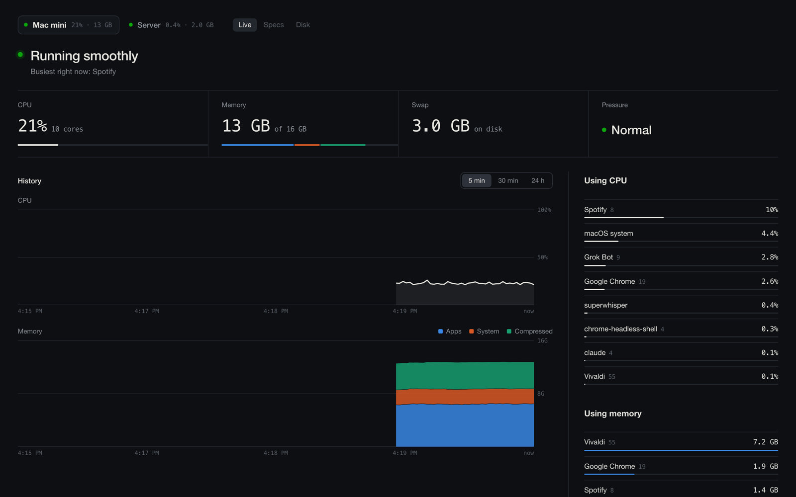
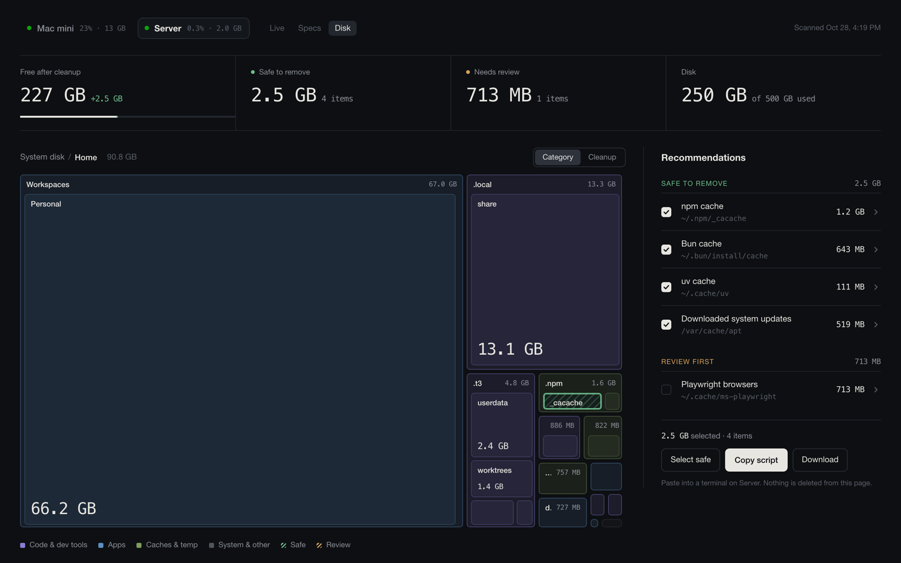
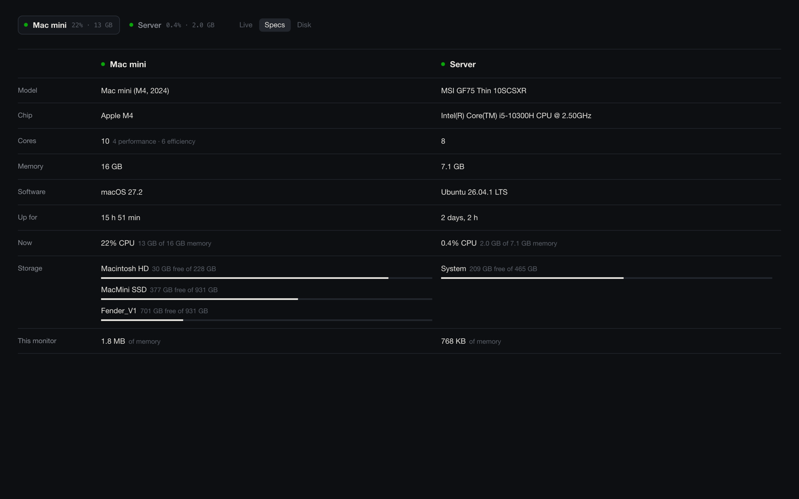

# Monitor

A tiny, self-hosted system monitor for macOS and Linux. One binary per machine serves a web page with:

- **Live**: CPU, memory, swap and memory pressure every 2 seconds, with a plain-English verdict ("Running smoothly", "Memory is tight: Chrome is using 7 GB"), 5 min / 30 min / 24 h history, and the apps using the most CPU and memory right now.
- **Specs**: every machine side by side (model, chip, cores, memory, OS, uptime, free space on each disk).
- **MCP**: every monitor is an MCP server, so agents can check on your machines, explain a slowdown or clean up a disk (see below).
- **Disk**: a zoomable treemap of what's filling your disk, plus cleanup recommendations sorted into *safe to remove* and *review first*. Tick what you want and copy a script. Nothing is ever deleted from the page.

Add your other machines with `--peer` and the page switches between all of them.





## For agents: MCP

Every monitor is also an [MCP](https://modelcontextprotocol.io) server at `/mcp`, so your agents can ask "how are my machines doing?" or "why is my disk full?" directly. One connection covers every machine the monitor knows about.

| Tool | |
|---|---|
| `status` | Verdict, CPU, memory, swap, pressure, uptime, disks and top apps, for one machine or all |
| `top_apps` | Apps using the most CPU or memory right now |
| `history` | Last 30 min or 24 h: averages, peaks, high-pressure periods, CPU spikes and the app behind each, gaps |
| `disk` | Free space, biggest folders (drill into any folder), cleanup suggestions with exact commands |
| `machines` | Every machine: online, specs, whether cleanup is allowed, its MCP URL |
| `scan_disk` | Start a fresh disk scan (read-only) |
| `run_cleanup` | Run cleanup suggestions. Off unless the monitor runs with `--allow-cleanup`; always two steps: the agent gets the exact commands and a one-time code, shows you, and only runs them with the code after you approve. Never runs `sudo` |

Connect it:

```sh
claude mcp add --transport http --scope user monitor http://127.0.0.1:8620/mcp    # Claude Code
codex mcp add monitor --url http://127.0.0.1:8620/mcp                             # Codex
```

From another machine, use its HTTPS address instead (`https://<machine>.<tailnet>.ts.net:8620/mcp`). For apps that only launch local commands (Claude Desktop), `monitor mcp [--url URL]` is a stdio bridge to a monitor's `/mcp`. `/mcp` refuses requests from web pages on other origins.

## Why it's small

The monitor is about 650 KB of Rust with two dependencies (`libc` and `serde_json`). It reads the OS directly (Mach and libproc on macOS, `/proc` on Linux) instead of running `ps` or `top`, and uses about 2 MB of memory on a Mac and under 1 MB on Linux. History is kept in memory (30 min at 2 s) and in a small `history.tsv` (24 h of 1-minute averages) so it survives restarts. The page is a single HTML file compiled into the binary.

## Install

**Setting this up with an AI agent?** Point it at [AGENTS.md](AGENTS.md): exact install, verification, multi-machine and troubleshooting steps.

```sh
curl -fsSL https://raw.githubusercontent.com/calebfender/monitor/main/install.sh | sh
```

Then open http://127.0.0.1:8620. The installer downloads the binary for your platform into `~/.local/share/monitor` and runs it as a user service: a launchd agent on macOS, `systemctl --user` units on Linux (plus a nightly disk-scan timer). Run it again any time to update. To remove it:

```sh
curl -fsSL https://raw.githubusercontent.com/calebfender/monitor/main/install.sh | sh -s -- --uninstall
```

Options after `sh -s --` are passed to the monitor:

```sh
curl -fsSL .../install.sh | sh -s -- --name "Studio" --peer "Server=https://server.example.ts.net:8620"
```

From a checkout, with Rust installed: `./install.sh --from-source`.

### Options

| Option | Default | |
|---|---|---|
| `--port N` | `8620` (or `$PORT`) | Port to listen on |
| `--bind ADDR` | `127.0.0.1` | Use `0.0.0.0` to listen on your network |
| `--name NAME` | hostname | What the page calls this machine |
| `--peer NAME=URL` | | Another machine's monitor to show as a tab. Repeatable |
| `--allow-origin URL` | | Let a page at another address read this monitor. Peers are allowed already |
| `--dir PATH` | `~/.local/share/monitor` | Where `history.tsv` and the disk scan live |
| `--allow-cleanup` | off | Let MCP clients run cleanup suggestions, after the user confirms each run |

## Several machines

Install the monitor on each machine and tell each one about the others:

```sh
# on the Mac
sh -s -- --name "Mac" --peer "Server=https://server.example.ts.net:8620"
# on the server
sh -s -- --name "Server" --peer "Mac=https://mac.example.ts.net:8620"
```

Each page reads the other monitors directly from your browser, and each monitor only answers cross-origin requests from its peers. The page you open has to be able to reach every peer's URL, and if the page is on HTTPS the peers must be too (browsers block HTTPS pages from fetching plain HTTP).

## Reaching it from other devices

The monitor has no login: anyone who can reach the port can see your process names and disk layout. It listens on `127.0.0.1` by default, so put something in front of it rather than opening it to the internet. [Tailscale](https://tailscale.com) is the easiest, and gives you HTTPS for free:

```sh
tailscale serve --bg --https=8620 http://127.0.0.1:8620
```

Now `https://<machine>.<tailnet>.ts.net:8620` works from your phone and your other machines, and nowhere else. A reverse proxy (Caddy, nginx) on a private network works too. If you must use `--bind 0.0.0.0`, keep it on a network you trust.

## The disk map

`scan.py` (Python 3, standard library only) measures your disk with `du` and writes `data.json` next to the monitor; the Disk tab appears once that file exists.

- **Linux**: the installer adds `monitor-scan.timer`, which rescans every night at 4:30. Run `python3 ~/.local/share/monitor/scan.py` to scan now.
- **macOS**: run `python3 ~/.local/share/monitor/scan.py` from Terminal (a couple of minutes). macOS privacy protection stops background services from reading your home folder, so it can't run on a timer. Give Terminal Full Disk Access in System Settings → Privacy & Security for the most complete map.

Recommendations come from rules for things that are safe to rebuild or worth a look: package-manager caches (npm, pnpm, Yarn, Bun, pip, uv, Cargo, Go), Homebrew downloads, Xcode build files, simulators and device support, Playwright browsers, AI models (Hugging Face, Ollama, LM Studio, Chrome's on-device model), old `node_modules`, unused Docker data, apt/dnf/pacman caches, the systemd journal, Trash and Downloads. On macOS, if [Mole](https://github.com/tw93/Mole) is installed (`brew install mole`), its tested rules decide which caches are safe and its dry run becomes the first recommendation.

Every recommendation shows the exact command it would run. The page only builds a script for you to read and paste into a terminal yourself.

## How it groups apps

- **macOS**: helper processes are grouped under their app (every `Google Chrome Helper` counts as Google Chrome). The monitor runs unprivileged, so processes owned by root or other users can't be read individually; the CPU they use shows up as "macOS system".
- **Linux**: processes are grouped by their systemd unit, so a server shows `nginx`, `postgresql` or `my-api` instead of a pile of `node` and `python3`. Kernel threads count as "Linux kernel".

## API

Everything the page shows is plain JSON, if you'd rather build on it:

| Endpoint | |
|---|---|
| `GET /api/live?since=MS` | Current CPU, memory, top apps, and 2-second samples newer than `since` (Unix ms) |
| `GET /api/day` | 24 h of 1-minute averages |
| `GET /api/info` | Hardware, OS, uptime and disks |
| `GET /api/config` | This machine's name and its peers |
| `GET /data.json` | The latest disk scan |
| `POST /mcp` | MCP (streamable HTTP, JSON responses) |

## Build

```sh
cargo build --release          # target/release/monitor
```

The page (`index.html`) and icons are compiled into the binary, so rebuild after changing them. Linux binaries cross-compile from a Mac with the `rust-lld` that ships with Rust:

```sh
rustup target add x86_64-unknown-linux-musl
PATH="$(rustc --print sysroot)/lib/rustlib/$(rustc -vV | sed -n 's/host: //p')/bin:$PATH" \
CARGO_TARGET_X86_64_UNKNOWN_LINUX_MUSL_LINKER=rust-lld \
cargo build --release --target x86_64-unknown-linux-musl
```

Releases are built by GitHub Actions when a `v*` tag is pushed (`.github/workflows/release.yml`).

## Platforms

macOS (Apple silicon and Intel) and Linux (x86_64 and arm64, any distro; systemd for the installer's service). No Windows.

## License

MIT
